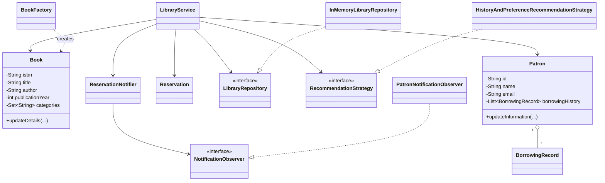

# Library Management System

An in-memory Java 17 library management system demonstrating object-oriented design, SOLID principles, Java collections, Java Util Logging, and reusable design patterns. Persistence and external APIs are intentionally outside the scope of this assignment.

## Features

- Add, update, remove, and search books by title, author, or ISBN.
- Add and update patrons, including preferred categories.
- Check books out and return them while maintaining availability and borrowing history.
- Reserve checked-out books in a FIFO queue.
- Notify the next patron when a reserved book is returned.
- Recommend books using borrowing history and patron category preferences.
- Log important catalog, patron, lending, and reservation events with Java Util Logging.

## Requirements

- Java 17+
- Maven 3.8+

## Run tests

```bash
mvn test
```

## Design overview

`LibraryService` is the application facade. It depends on abstractions (`LibraryRepository` and `RecommendationStrategy`) so storage and recommendation algorithms can change independently. `InMemoryLibraryRepository` is the current persistence-free implementation.

The design applies the following principles and patterns:

- Encapsulation: domain state is private and exposed through read-only views where appropriate.
- Single Responsibility: domain objects, repository storage, notifications, recommendations, and orchestration have separate responsibilities.
- Open/Closed and Dependency Inversion: new repository implementations and recommendation strategies can be added without changing `LibraryService`.
- Observer: `ReservationNotifier` publishes availability events to `NotificationObserver` implementations such as `PatronNotificationObserver`.
- Strategy: `RecommendationStrategy` allows recommendation algorithms to be selected or replaced at runtime.
- Factory: `BookFactory` centralises validated book creation.

## Class diagram



## Example usage

```java
var repository = new InMemoryLibraryRepository();
var notifier = new ReservationNotifier();
var library = new LibraryService(
        repository,
        new HistoryAndPreferenceRecommendationStrategy(),
        notifier);

library.addBook(BookFactory.create(
        "Clean Code", "Robert Martin", "9780132350884", 2008,
        Set.of("software", "programming")));
library.addPatron(new Patron("p-100", "Asha", "asha@example.com"));
library.checkoutBook("9780132350884", "p-100");
library.returnBook("9780132350884", "p-100");
```

## Scope notes

The current implementation models one library inventory. Multi-branch support can be added behind the repository/service abstractions by introducing a `Branch` aggregate and branch-aware inventory/transfer operations.
